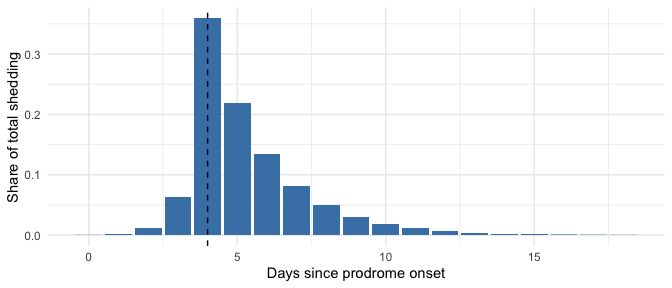
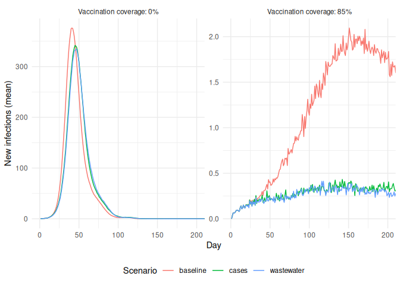

# Measles wastewater surveillance with epiworldR


This project simulates measles outbreaks in a synthetic city of 10,000
people and compares three scenarios:

1.  **Baseline**: the outbreak runs with no surveillance-triggered
    intervention.
2.  **Wastewater (WW)**: wastewater is sampled three times a week,
    results are available after a lab turnaround time, and an
    intervention starts once a result reaches a threshold.
3.  **Cases**: a fraction of rash cases are reported after a delay, and
    the same intervention starts once cumulative reported cases reach a
    threshold.

The intervention reduces the non-household contacts (school, work, and
other settings) of school-age groups (5–19) by 80% for the rest of the
outbreak. The WW threshold is calibrated so both triggers respond to the
same number of cases; the difference between them is *when* each system
sees those cases.

## Model

### Population and contacts

- **Disease model**: `measles::ModelMeaslesMixing()` (latent, prodromal,
  rash, hospitalized, recovered), with one entity per 5-year age group
  (0–4, …, 75+). Individual-level isolation, quarantine, and contact
  tracing are off in every scenario, so the only response is the
  triggered intervention.
- **Age distribution**: Salt Lake County, UT (2025 Census estimates, via
  the
  [multigroup.vaccine](https://github.com/EpiForeSITE/multigroup-vaccine)
  package), rescaled to 10,000 people.
- **Contacts**: the setting-specific (household, school, work, other)
  contact matrices from
  [Epistorm-Mix](https://github.com/epistorm/Epistorm-Mix) (see
  [data/epistorm](data/epistorm/README.md)), re-weighted to the county’s
  age distribution and made reciprocal with
  `measles::make_cmat_symmetric()`.
- **Transmission**: the contact matrix is scaled to R0 = 7 (a
  parameter), first analytically and then by simulation, because the
  agent-based model realizes a lower R0 than the analytic formula. The
  simulated R0 is 6.91. Under the intervention it drops to about 5.4;
  school-age contacts outside the home account for only part of
  transmission.
- **Natural history**: 10 days latent, 4 days prodromal, and 4 days of
  rash. That puts rash onset about 14 days after infection and makes
  people infectious from 4 days before to 4 days after rash onset.
  People with rash keep 50% of their contacts. 20% are hospitalized.

### Wastewater shedding

The shedding model follows the structure of the CDC
[wwinference](https://github.com/CDCgov/ww-inference-model) model. The
expected concentration on day $t$ is

$$C(t) = \frac{1}{\alpha N} \sum_{\tau=0}^{\tau_{end}} s(\tau)\, G(t - \tau),$$

where $G(d)$ is the total number of genome copies shed by the people
whose prodrome started on day $d$, $\alpha$ is the wastewater volume per
person per day, and $N$ is the population. The shedding profile
$s(\tau)$ is piecewise linear on the log10 scale: it rises to its peak
at $\tau_{peak}$ and declines back to zero at $\tau_{end}$, normalized
to sum to one. Two changes from the COVID model:

- $\tau$ is counted from **prodrome onset**, not infection, because
  measles RNA appears in urine during the prodrome and peaks around rash
  onset.
- Each person’s total shedding is drawn from a log-normal distribution,
  since measured measles shedding varies over four orders of magnitude.

Measurements are log-normal around $C(t)$ and recorded as non-detects
below the limit of detection (LOD).

| Parameter | Value | Source |
|----|----|----|
| Peak shedding, days after prodrome onset ($\tau_{peak}$) | 4 (rash onset) | Prodromal and rash-onset shedding (Corchis-Scott et al. 2026) |
| End of shedding ($\tau_{end}$) | 18 (≈14 days after rash) | Urine RNA up to 14 days (Corchis-Scott et al. 2026); RT-PCR positive up to 10+ days after rash (CDC) |
| Peak-to-tail ratio (log10) | 3 | Assumption (shape only; profile is normalized) |
| Copies per infection, log10 mean (SD) | 10 (1) | ≈10^8.7 copies/infection/day over ≈2 weeks (STOTEN 2024 model); median 1.4×10^11 copies/person/day, 4 orders of magnitude range (Corchis-Scott et al. 2026) |
| Wastewater per person per day ($\alpha$) | 378,500 mL | wwinference (Ortiz 2024) |
| Measurement SD (log scale) | 0.5 | Assumption |
| LOD | 1 copies/mL (3 log10 copies/L) | Process LOD in STOTEN 2024 |
| Sampling | 3 times a week | Ontario (Corchis-Scott et al. 2026) |
| Lab turnaround | 3 days (sensitivity 0–7) | Assumption |
| Cases reported | 50%, 3 days after rash | Assumption; Ontario estimated 5–10× under-reporting |
| Case trigger | 5 cumulative reported cases | Assumption |

With these values, one person with median shedding, on their peak day,
in a city of 10,000 produces a concentration near the LOD, roughly in
line with the STOTEN 2024 estimate that about 8 cases per 10,000 people
are needed for 50% detection.

``` r
k <- shedding_kernel(p$ww_t_peak, p$ww_t_end, p$ww_log10_vpeak)
ggplot(data.frame(tau = seq_along(k) - 1, s = k), aes(tau, s)) +
  geom_col(fill = "steelblue") +
  geom_vline(xintercept = p$prodromal_period, linetype = 2) +
  labs(x = "Days since prodrome onset", y = "Share of total shedding") +
  theme_minimal()
```

<div id="fig-kernel">



Figure 1: Shedding profile, relative to prodrome onset. The dashed line
marks rash onset.

</div>

### Calibrating the triggers

The clinical system sees a case at rash onset, but only after the
reporting delay. WW sees it from the prodrome, but only after the lab
turnaround. The WW threshold is calibrated on the baseline runs so that,
at the median, both triggers fire after the same number of cases:

- **Cases**: cumulative rash onsets on the rash day of the report that
  crosses the case threshold.
- **WW**: cumulative prodrome onsets on the collection day of the first
  sample above the WW threshold.

Both medians are taken over the same runs, those where the case trigger
fires. If WW never crosses the threshold in one of those runs, it counts
as WW never seeing the outbreak, so a threshold cannot look well
calibrated just by missing the outbreaks it would detect late.

Because runs with the same seed share their trajectory until the
trigger, the scenarios are paired, and the lead time is the case trigger
day minus the WW trigger day in the same outbreak.

## Results

Each scenario was simulated 400 times (`analysis/run-scenarios.R`) for
two levels of vaccination coverage: none (R0 = 7 in a fully susceptible
city) and 85% (effective R ≈ 1.2). Each simulation starts from a single
introduction. Summaries only include runs in which the baseline produced
an outbreak (50 or more infections), and the “Outbreaks” column gives
their share. “Infected at trigger” and “Reported at trigger” are medians
on the trigger day.

<div id="tbl-summary">

Table 1

<div class="cell-output-display">

| Coverage | Outbreaks (%) | Scenario | WW threshold (copies/mL) | Trigger day | Infected at trigger | Reported at trigger | Infections, median \[IQR\] | Averted vs baseline, mean | Lead of WW over cases (days) |
|:---|:---|:---|:---|:---|:---|:---|:---|:---|:---|
| 0% | 96 | baseline |  |  |  |  | 9,976 \[9,972, 9,979\] |  |  |
| 0% | 96 | wastewater | 7.1 | 22 | 72 | 2 | 9,952 \[9,946, 9,956\] | 50 | 3 |
| 0% | 96 | cases |  | 26 | 158 | 5 | 9,952 \[9,948, 9,957\] | 23 |  |
| 85% | 40 | baseline |  |  |  |  | 891 \[836, 938\] |  |  |
| 85% | 40 | wastewater | 12.6 | 46 | 15 | 3 | 270 \[49, 405\] | 622 | 6 |
| 85% | 40 | cases |  | 50 | 20 | 5 | 242 \[64, 381\] | 630 |  |

</div>

</div>

``` r
curves <- rbindlist(lapply(res, `[[`, "curves"))
curves[, coverage := paste0("Vaccination coverage: ", 100 * coverage, "%")]
ggplot(curves, aes(day, new_inf, colour = scenario)) +
  geom_line() +
  facet_wrap(~coverage, scales = "free_y") +
  labs(x = "Day", y = "New infections (mean)", colour = "Scenario") +
  coord_cartesian(xlim = c(0, 200)) +
  theme_minimal() +
  theme(legend.position = "bottom")
```

<div id="fig-curves">



Figure 2: Mean daily new infections by scenario.

</div>

### Takeaways

- **Without vaccination**, WW triggers a median of 3 days before the
  case-based trigger. At that point about 72 people are infected and 2
  cases have been reported. The case trigger fires at about 158 infected
  and 5 reported. Both thresholds respond to the same number of cases
  (about 11); WW simply sees them earlier. However, the school-age
  intervention only lowers R from 7 to about 5.4, so neither trigger
  stops a city-wide outbreak.
- **With 85% coverage** (effective R ≈ 1.2), the same intervention
  brings R just below one (≈ 0.95) and averts most infections. But the
  outbreak grows slowly, so a lead of a few days barely changes the
  number infected at the trigger. The differences between the WW and
  case-based scenarios are within simulation noise.
- The WW lead comes from shedding during the prodrome (about 4 days
  before rash) plus the case-reporting delay, minus the lab turnaround.
  Each extra day of turnaround removes about one day of lead. With a
  7-day turnaround, the median lead is -1 days without vaccination and 2
  days with 85% coverage (table below).
- Earlier detection pays off most when the outbreak grows fast *and* the
  triggered intervention is strong enough to bring R below one. With R0
  = 7 and no vaccination, that would take broader measures than reducing
  school-age contacts.

### Lab turnaround time

The value of earlier detection shrinks as the lab turnaround time grows.
Here the WW threshold is fixed at its calibrated value:

<div id="tbl-lab">

Table 2

<div class="cell-output-display">

| Coverage | Lab turnaround (days) | Trigger day | Lead of WW over cases (days) | Infections averted, mean |
|:---|---:|:---|:---|:---|
| 0% | 0 | 19 | 6 | 49 |
| 0% | 1 | 20 | 5 | 50 |
| 0% | 3 | 22 | 3 | 50 |
| 0% | 5 | 24 | 1 | 49 |
| 0% | 7 | 26 | -1 | 50 |
| 85% | 0 | 43 | 9 | 637 |
| 85% | 1 | 44 | 8 | 635 |
| 85% | 3 | 46 | 6 | 622 |
| 85% | 5 | 48 | 4 | 619 |
| 85% | 7 | 50 | 2 | 622 |

</div>

</div>

## Reproducing

The analysis needs epiworldR 0.19.0, measles 0.4.1, and
multigroup.vaccine 0.1.1, which are installed from GitHub at pinned
commits. The easiest way to get them is the dev container
(`.devcontainer/Containerfile`), which also pins the R version and the
CRAN snapshot:

- **In the browser**: [](https://codespaces.new/EpiForeSITE/wastewater-econ-abm?devcontainer_path=.devcontainer/web/devcontainer.json)
  (uses `.devcontainer/web/devcontainer.json`).
- **Locally**: open the project in VS Code with the Dev Containers
  extension (uses `.devcontainer/devcontainer.json`), or build the image
  directly with
  `docker build -f .devcontainer/Containerfile .devcontainer`.

The image is built and tested by the `Dev container` GitHub Actions
workflow, and published as `ghcr.io/epiforesite/wastewater-econ-abm-dev`
from `main`. Inside the container:

``` r
source("analysis/run-scenarios.R")   # writes analysis/results.rds
quarto::quarto_render("README.qmd")
tinytest::run_test_dir("tests")
```

All parameters are set in `measles_ww_params()` (R/simulate.R) and can
be changed, e.g., `measles_ww_params(R0 = 12, ww_lab_delay = 5)`.

## References

- CDC wwinference model: <https://github.com/CDCgov/ww-inference-model>
- Corchis-Scott R. et al. Wastewater surveillance to track resurgent
  measles outbreak, Ontario, Canada, 2025. *Emerg Infect Dis*
  2026;32(10). <https://wwwnc.cdc.gov/eid/article/32/10/26-0092_article>
- Temporal, spatial, and methodological considerations in evaluating the
  viability of measles wastewater surveillance. *Sci Total
  Environ* 2024.
  <https://www.sciencedirect.com/science/article/abs/pii/S0048969724082998>
- Measles RNA detection in wastewater solids: longitudinal monitoring at
  a national scale.
  <https://pubs.rsc.org/ew/article/12/7/2074/1223010/Measles-RNA-detection-in-wastewater-solids>
- Genotype-specific detection of measles virus using wastewater
  surveillance, Wisconsin, 2026. *MMWR* 75(27).
  <https://www.cdc.gov/mmwr/volumes/75/wr/mm7527a1.htm>
- Wastewater surveillance for measles virus during a measles outbreak,
  Colorado, 2025.
  <https://www.ncbi.nlm.nih.gov/pmc/articles/PMC12806976/>
- Litvinova M. et al. Epistorm-Mix. medRxiv 2025.11.20.25340662.
- Klinkenberg D., Nishiura H. The correlation between infectivity and
  incubation period of measles. *J Theor Biol* 2011.
