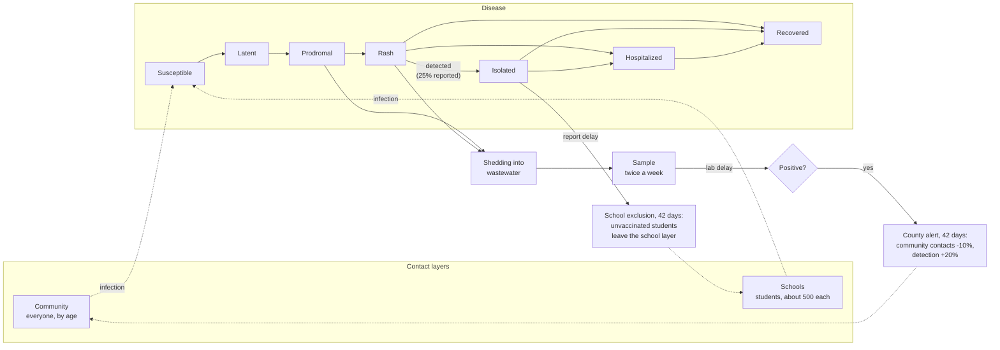

# Measles wastewater surveillance in Salt Lake County

This repository simulates measles outbreaks in a synthetic Salt Lake County
population to estimate what a wastewater surveillance program adds to the
usual case-based response. It produces outcomes for an economic evaluation:
infections, hospital admissions and bed-days, school exclusions, wastewater
samples and alerts, and the contact reductions alerts cause. The model is an
exploratory simulation, not a forecast.

## The model

The model is an agent-based model built with the `v1-layers` branch of
[epiworldR](https://github.com/UofUEpiBio/epiworldR) (pinned in the
devcontainer). It has 120,000 agents, a tenth of the county, with its age
structure and school MMR coverage.

- **Contacts.** Everyone mixes in a community layer by age group. Students
  also join one school of about 500, where every pair of schoolmates meets
  with the same daily probability. Contacts come from the Epistorm-Mix
  setting matrices; school contacts are moved from the community layer to the
  school layer, so a student's total contacts match the data.
- **Disease.** Infection, a latent period, an infectious prodrome, and an
  infectious rash. A quarter of cases are reported, as estimated for an
  outbreak in southwest Utah: hospitalized cases (2% of infections)
  and cases detected during rash are isolated and reported three days
  later.
- **Case response.** A reported student case excludes the school's
  unvaccinated students for 42 days after its last reported case.
- **Wastewater.** Infected agents shed into one county-wide catchment
  from prodrome onset (about four days before rash) for about two weeks.
  Samples are taken twice a week and return a result some days later; a
  positive result starts a 42-day county-wide alert that reduces community
  contacts by 10% and raises the daily detection probability by 20%.
- **Calibration.** The per-contact transmission probability is set so that
  an imported case causes seven secondary infections on average in a fully
  susceptible population.

## Scenarios

Scenarios are defined in [scenarios.yml](scenarios.yml); each changes some
of the default parameters in [data/parameters.csv](data/parameters.csv).

| Scenario | Response |
|:---|:---|
| [baseline](scenarios/baseline.md) | School exclusions after reported cases; no wastewater action |
| [wastewater](scenarios/wastewater.md) | Baseline plus wastewater alerts: samples twice a week, results in 4 days |
| [wastewater-fast](scenarios/wastewater-fast.md) | As above, with results in 2 days |

Every scenario runs the same replicates: the same origin school, population,
vaccination and random draws, so outcomes can be compared replicate by
replicate. [scenarios/README.md](scenarios/README.md) compares them.

## Workflow

1. Edit parameters in [data/parameters.csv](data/parameters.csv) or add a
   scenario to [scenarios.yml](scenarios.yml) (and to `SCENARIOS` in the
   [Makefile](Makefile)).
2. Run `make <scenario>` for one scenario, or `make` for all of them and the
   comparison. Each run copies [report.qmd](report.qmd) to
   `<scenario>.qmd`, renders it with the scenario as a parameter, and moves
   the report to `scenarios/<scenario>.md`.
3. Read the report in [scenarios/](scenarios), and use the tables in
   `results/<scenario>/`, described in [results/README.md](results/README.md).

`make test` runs the tests in [tests/](tests). `WASTEWATER_NSIMS` (default
200) and `WASTEWATER_CORES` (default 5) set the replicates and cores, e.g.
`WASTEWATER_NSIMS=10 make baseline` for a quick check. With 200
replicates on five cores, `make` takes about nine minutes.

## Repository

| Path | Contents |
|:---|:---|
| [model.R](model.R) | Model builder, response event, and population helpers |
| [report.qmd](report.qmd) | Parameterized report that runs one scenario |
| [scenarios.yml](scenarios.yml) | Scenario definitions |
| [data/](data) | Parameters, contact matrices, and Utah school data |
| [scenarios/](scenarios) | Rendered reports and the comparison |
| [results/](results) | Simulation outputs for the economic evaluation |
| [tests/](tests) | tinytest tests |
