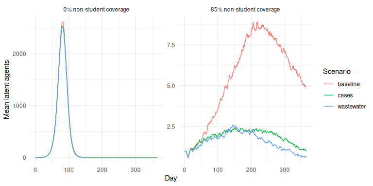

# Measles wastewater surveillance with epiworldR


This document builds and runs a measles model with community and school
contact layers. It compares no intervention, an intervention triggered
by wastewater, and an intervention triggered by reported cases. The
model is an exploratory simulation, not a forecast.

The devcontainer pins epiworldR to commit
`2f1a5acc7835c44908fab53261d879afc4335e51` and the Census helper package
to `ddd9201f28b9908c033542f6a2445b84619af1c7`. Its dependency versions
are checked in
[.devcontainer/check-dependencies.R](.devcontainer/check-dependencies.R).
Run `quarto render README.qmd` from the repository root to reproduce the
report.

## Parameters and population

The latent, prodromal and rash periods are lognormal draws. Lessler et
al. ([2009](https://doi.org/10.1016/S1473-3099(09)70069-6)) inform the
incubation standard deviation; the prodromal standard deviation comes
from the Hagelloch data, and the rash standard deviation is assumed. See
[data/parameters.csv](data/parameters.csv) for parameter sources.

``` r
library(epiworldR)
library(data.table)
library(ggplot2)
source("model.R")
set.seed(137)

p <- list(
  n                           = 10000,
  n_seed                      = 1,
  R0                          = 7,
  vax_efficacy                = 0.97,
  transmission_rate           = 0.9,
  incubation_period           = 10,
  incubation_period_sd        = 2.5,
  prodromal_period            = 4,
  prodromal_period_sd         = 1.7,
  rash_period                 = 4,
  rash_period_sd              = 1,
  rash_reduction_contact_rate = 0.5,
  prob_hospitalization        = 0.2,
  hospitalization_period      = 7,
  ndays                       = 365,
  ww_t_peak                   = 4,
  ww_t_end                    = 18,
  ww_log10_vpeak              = 3,
  ww_log10_g_mean             = 10,
  ww_log10_g_sd               = 1,
  ww_alpha                    = 378500,
  ww_sigma                    = 0.5,
  ww_lod                      = 1,
  ww_sampling_days            = c(1, 3, 5),
  ww_lab_delay                = 3,
  case_report_prob            = 0.7,
  case_report_delay           = 3,
  trigger_cases               = 5,
  trigger_ww                  = 1,
  school_contact_reduction    = 0.8
)
# Default to 200 runs; a smaller value is useful while editing the report.
nsims <- as.integer(Sys.getenv("WASTEWATER_NSIMS", unset = "200"))
stopifnot(nsims > 0)
```

The application uses Census population estimates for Salt Lake County
and Utah school records, weighted by district ACS population estimates.
Each agent is in the community layer; students also join one school. Age
groups are five-year bands, so school levels and enrollment are
approximations. See [data/utah/README.md](data/utah/README.md) for the
sources and limitations.

``` r
# County age distribution, rounded to the model's population size.
age_limits <- seq(0, 75, by = 5)
census_path <- system.file(
  "extdata", "cc-est2025-syasex-49.csv", package = "multigroup.vaccine"
)
census <- multigroup.vaccine::getCensusData(
  state_fips  = "49",
  county_name = "Salt Lake County",
  year        = 2025,
  age_groups  = age_limits,
  csv_path    = census_path
)
shares <- census$age_pops / sum(census$age_pops)
pop <- floor(shares * p$n)
remaining <- p$n - sum(pop)
if (remaining > 0) {
  extra <- order(shares * p$n - pop, decreasing = TRUE)[seq_len(remaining)]
  pop[extra] <- pop[extra] + 1
}

# Reweight national setting-specific matrices and make contacts reciprocal.
us_path <- system.file(
  "extdata", "nc-est2025-agesex-res.csv", package = "multigroup.vaccine"
)
us <- read.csv(us_path)
us <- us[us$SEX == 0 & us$AGE < 999, ]
us_pop <- tapply(us$POPESTIMATE2025, findInterval(us$AGE, age_limits), sum)
weights <- (pop / sum(pop)) / as.numeric(us_pop / sum(us_pop))
settings <- c("Household", "Work", "Other")
community <- matrix(0, nrow = length(pop), ncol = length(pop))
for (setting in settings) {
  path <- file.path("data/epistorm", paste0(setting, "-M-by5_75-matrix.csv"))
  matrix_data <- read.csv(path, check.names = FALSE)
  contacts <- as.matrix(matrix_data[, -1])
  contacts <- t(t(contacts) * weights)
  total <- contacts * as.numeric(pop)
  community <- community + (total + t(total)) / 2 / as.numeric(pop)
}
community <- community * 0.2

# Weight each school's within-district share by ACS district population.
schools <- read.csv(
  "data/utah/school_district_schoolID_data_Utah_2025.csv"
)
schools <- schools[schools$county == "Salt Lake", ]
acs <- read.csv(
  "data/utah/acs_Utah_2023_school_districts.csv",
  check.names  = FALSE,
  fileEncoding = "UTF-8-BOM"
)
district <- unique(schools$schooldistrictlocation)
labels <- ifelse(
  test = district == "SALT LAKE",
  yes  = "Salt Lake City",
  no   = tools::toTitleCase(tolower(district))
)
columns <- paste0(labels, " School District, UT")
district_pop <- vapply(
  X         = columns,
  FUN       = function(col) sum(acs[[col]][acs[[1]] %in% c(5, 10, 15, 16)]),
  FUN.VALUE = numeric(1)
)
school_weight <- district_pop[match(schools$schooldistrictlocation, district)] *
  schools$popfrac

# Assign students to schools by age band and retain school MMR coverage.
age_group <- rep(seq_along(pop) - 1L, pop)
level <- rep(NA_integer_, p$n)
level[age_group == 1L] <- 1L
level[age_group == 2L] <- 2L
older <- which(age_group == 3L)
level[older[sample.int(length(older), floor(length(older) * 3 / 5))]] <- 3L
school_row <- rep(NA_integer_, p$n)
for (j in 1:3) {
  students <- which(level == j)
  choices <- which(schools$level == j)
  school_row[students] <- choices[sample.int(
    n       = length(choices),
    size    = length(students),
    replace = TRUE,
    prob    = school_weight[choices]
  )]
}
school_group <- match(schools$id[school_row], unique(schools$id)) - 1L
sizes <- tabulate(school_group + 1L, nbins = length(unique(schools$id)))
school_probability <- pmin(1, 4 / pmax(1, sizes - 1L))

# The shedding kernel is normalized to one per prodromal-onset cohort.
tau <- 0:p$ww_t_end
log_shedding <- ifelse(
  test = tau <= p$ww_t_peak,
  yes  = p$ww_log10_vpeak * tau / p$ww_t_peak,
  no   = p$ww_log10_vpeak * (p$ww_t_end - tau) / (p$ww_t_end - p$ww_t_peak)
)
kernel <- 10^log_shedding
kernel <- kernel / sum(kernel)
setup <- list(
  persons            = list(age_group = age_group, school = school_group),
  community          = community,
  school_probability = school_probability,
  vaccinated         = integer(),
  kernel             = kernel
)
```

## Calibrate contacts

We adjust the two layers together using simulations in a fully
susceptible population, targeting an average of seven secondary
infections per imported case. This target is an illustrative assumption
below published measles estimates. Because the calibration is simulated,
the estimate varies.

``` r
# Reuse the same fully susceptible population to calibrate both layers.
cal_p <- p
cal_p$n_seed <- 10
cal_p$ndays <- 60
for (iteration in 1:4) {
  state <- new.env(parent = emptyenv())
  model <- build_model(cal_p, setup, state, scenario = "baseline")
  run_multiple(
    m        = model,
    ndays    = cal_p$ndays,
    nsims    = 50,
    seed     = 42,
    saver    = make_saver("reproductive"),
    nthreads = 1,
    verbose  = FALSE
  )
  reproduction <- run_multiple_get_results(model, nthreads = 1)$reproductive
  r0 <- sum(
    reproduction$rt[
      reproduction$source >= 0 & reproduction$source_exposure_date == 0
    ]
  ) / (50 * cal_p$n_seed)
  if (!is.finite(r0) || r0 <= 0) stop("Calibration produced no transmission")
  if (iteration < 4) {
    setup$community <- setup$community * p$R0 / r0
    setup$school_probability <- pmin(
      1, setup$school_probability * p$R0 / r0
    )
  }
}
r0
```

    [1] 7.052

## Run the scenarios

We run 200 simulations per scenario for each of two non-student
vaccination rates: 0% and 85%. Students retain their school-specific MMR
coverage. The same synthetic population and vaccination assignments are
held fixed within a coverage scenario. Vaccination reduces
susceptibility by 97%.

The baseline records both wastewater and case surveillance without
changing contacts. We select the wastewater threshold so the median
number of prodromal cases at collection matches the median number of
rash cases at the clinical report crossing the five-case threshold.
Non-detections count as missed outbreaks. The two intervention scenarios
then reduce school contacts by 80% when their trigger becomes available.
This is a simplified response; community contacts stay unchanged.

R global events cannot run in parallel threads, so these
`run_multiple()` calls use one thread. The simulation seed is the same
across scenarios, but R event draws use the document’s RNG stream;
outcomes are not treated as paired.

``` r
results <- list()
histories <- list()
for (coverage in c(0, 0.85)) {
  # Keep vaccine assignments fixed within this coverage scenario.
  vaccine_probability <- schools$vaxrate[school_row]
  vaccine_probability[is.na(vaccine_probability)] <- coverage
  setup$vaccinated <- which(runif(p$n) < vaccine_probability) - 1L

  # Run baseline and collect both stage histories and surveillance records.
  state <- new.env(parent = emptyenv())
  model <- build_model(p, setup, state, scenario = "baseline")
  run_multiple(
    m        = model,
    ndays    = p$ndays,
    nsims    = nsims,
    seed     = 42,
    saver    = make_saver("total_hist"),
    nthreads = 1,
    verbose  = FALSE
  )
  baseline_history <- run_multiple_get_results(model, nthreads = 1)$total_hist
  baseline_runs <- state$runs

  # Compare the cases seen by each surveillance system on eligible runs.
  case_day <- vapply(
    X         = baseline_runs,
    FUN       = function(x) which(cumsum(x$reported) >= p$trigger_cases)[1],
    FUN.VALUE = integer(1)
  )
  eligible <- which(!is.na(case_day))
  if (!length(eligible)) stop("No baseline run reached the case trigger")
  seen_cases <- vapply(
    X         = eligible,
    FUN       = function(i) baseline_runs[[i]]$cum_rash[
      max(1, case_day[i] - p$case_report_delay)
    ],
    FUN.VALUE = numeric(1)
  )
  thresholds <- 10^seq(0, 3, by = 0.05)
  seen_ww <- vapply(
    X         = thresholds,
    FUN       = function(threshold) {
      vapply(
        X         = eligible,
        FUN       = function(i) {
          x <- baseline_runs[[i]]
          day <- which(
            !is.na(x$ww_obs) & x$ww_obs >= threshold &
              seq_along(x$ww_obs) + p$ww_lab_delay <= p$ndays
          )[1]
          if (is.na(day)) Inf else x$cum_prod[day]
        },
        FUN.VALUE = numeric(1)
      )
    },
    FUN.VALUE = numeric(length(eligible))
  )
  medians <- apply(matrix(seen_ww, ncol = length(thresholds)), 2, median)
  p$trigger_ww <- thresholds[which.min(abs(medians - median(seen_cases)))]

  # The scenario output uses the native run_multiple saver.
  for (scenario in c("baseline", "wastewater", "cases")) {
    if (scenario == "baseline") {
      history <- baseline_history
      runs <- baseline_runs
    } else {
      state <- new.env(parent = emptyenv())
      model <- build_model(p, setup, state, scenario = scenario)
      run_multiple(
        m        = model,
        ndays    = p$ndays,
        nsims    = nsims,
        seed     = 42,
        saver    = make_saver("total_hist"),
        nthreads = 1,
        verbose  = FALSE
      )
      history <- run_multiple_get_results(model, nthreads = 1)$total_hist
      runs <- state$runs
    }
    key <- paste(coverage, scenario, sep = "-")
    final <- history[history$date == p$ndays &
                       history$stage == "Susceptible", ]
    results[[key]] <- data.frame(
      coverage     = coverage,
      scenario     = scenario,
      sim          = final$sim_num,
      infections   = p$n - final$counts,
      trigger_day  = vapply(runs, function(x) x$trigger_day, integer(1)),
      ww_threshold = p$trigger_ww
    )
    incidence <- as.data.table(history)[stage == "Latent", .(
      mean_latent = mean(counts)
    ), by = date]
    incidence[, `:=`(coverage = coverage, scenario = scenario)]
    histories[[key]] <- incidence
  }
}
results <- rbindlist(results)
histories <- rbindlist(histories)
```

## Results

The table summarizes all simulations, including introductions that die
out. Trigger days are medians among runs that triggered. Differences
between scenarios are descriptive and do not imply a paired comparison.

| coverage | scenario | runs | median_infections | infections_q25 | infections_q75 | triggered_pct | median_trigger_day | wastewater_threshold |
|:---|:---|---:|---:|---:|---:|---:|---:|---:|
| 0% | baseline | 200 | 8769.0 | 8750.5 | 8784.0 | 0.0 | NA | 5.0 |
| 0% | wastewater | 200 | 8615.5 | 8603.8 | 8630.2 | 98.5 | 29 | 5.0 |
| 0% | cases | 200 | 8619.5 | 8607.0 | 8630.2 | 98.0 | 37 | 5.0 |
| 85% | baseline | 200 | 3.0 | 1.0 | 486.8 | 0.0 | NA | 8.9 |
| 85% | wastewater | 200 | 3.0 | 1.0 | 42.2 | 51.0 | 39 | 8.9 |
| 85% | cases | 200 | 3.0 | 1.0 | 29.8 | 39.5 | 51 | 8.9 |

The curves show the mean number of agents in the latent stage, including
runs that die out; they are not restricted to large outbreaks.

<div id="fig-simple-latent">



Figure 1

</div>

School assignments approximate enrollment from district population
shares. Small simulated schools can have fewer possible contacts than
the target. The wastewater process assumes the whole modeled population
contributes to one catchment. The engine accepts zero or full stage
contact weights, so a random fraction of rash cases enters an isolated
stage at the end of the day; that transition redraws the rash duration.
These are modeling assumptions, not estimates validated against observed
Salt Lake County outbreaks.
