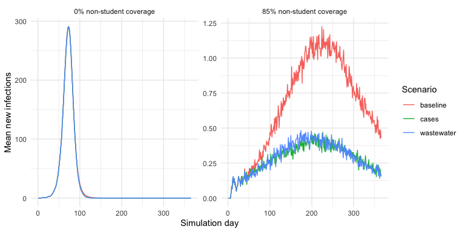

# Measles wastewater surveillance with epiworldR


This project models measles in a synthetic Salt Lake County population
with community and school contact layers. It compares no
surveillance-triggered intervention with case and wastewater triggers.
The model is an exploratory simulation, not an estimate of an actual
outbreak.

## Run the model

Install `epiworldR` from the `v1-layers` commit used here and install
`multigroup.vaccine`, `measles`, `data.table`, and `remotes`:

``` r
remotes::install_github("UofUEpiBio/epiworldR@2f1a5acc7835c44908fab53261d879afc4335e51")
```

From the repository root, run `Rscript analysis/run-layered-example.R`
for a single seeded comparison or `Rscript analysis/run-scenarios.R` for
the larger simulation study. Run
`Rscript -e 'tinytest::run_test_dir("tests")'` to check the code. A
UTF-8 locale may be required to read the Census files.

## Population and contacts

The 2025 county age distribution comes from Census data supplied by
`multigroup.vaccine`. School assignments use Utah school records and
2023 ACS district residential populations, as documented in
[data/utah](data/utah/README.md). These are approximate assignments, not
observed enrollment; five-year age bands are used as proxies for school
levels. Every agent participates in the community layer, and assigned
students also participate in one school group. School MMR coverage is
taken from the school data; `prop_vaccinated` sets coverage for other
agents. A vaccinated agent receives susceptibility reduction
`vax_efficacy`.

Community contacts use the household, work and other Epistorm-Mix
matrices. The school layer uses within-school mixing. Simulation scaling
can leave small school groups unable to achieve their target number of
contacts. The setup calibrates both layers against simulated
transmission in a fully susceptible population, including seeded cases
with no secondary infections.

## Measles and surveillance

The disease stages are susceptible, latent, prodromal, rash,
hospitalized and recovered. Latent, prodromal and rash durations are
independent lognormal draws with means and standard deviations in days,
rounded to whole days with a minimum of one. Defaults are 10 (SD 2.5), 4
(SD 1.7), and 4 (SD 1), respectively. Lessler et al. estimate exposure
to first symptoms, so applying that shape and SD to exposure to
infectiousness is an approximation; the prodromal SD comes from a
Hagelloch data fit and the rash SD is an assumption. See [Lessler et
al. (2009)](https://doi.org/10.1016/S1473-3099(09)70069-6) and the
[measles parameter
documentation](https://uofuepibio.github.io/measles/articles/parameters.html).

The layer engine currently accepts only zero or full stage contact
weights. To approximate reduced rash contact, a fraction of rash cases
is selected for isolation through a global event. Isolation takes effect
after the event and entry into the isolated stage draws a new rash
duration. This is an approximation and does not precisely preserve each
individual’s rash duration or partial contacts. Hospitalization competes
with rash recovery. The wastewater model uses the existing shedding
curve and assumes that the whole simulated population contributes to the
catchment. Detection triggers a reduction in school contacts; community
contacts remain unchanged.

## Simulation results

The results below use 400 paired simulations per scenario, a population
of 10,000 agents, one initial infection, and 365 days of follow-up. The
two coverage scenarios set vaccination among non-students to 0% and 85%;
school coverage remains school-specific in both scenarios. The
wastewater threshold is calibrated separately for each coverage scenario
against the case trigger. Agent and vaccination assignments are held
fixed across runs; epidemic seeds run from 1001 to 1400. An outbreak is
a baseline simulation with at least 50 infections. The outcome summaries
below are conditional on those baseline outbreaks; the outbreak
percentage uses all simulations. Scenario pairs share their random seed.

### Calibration and outbreak frequency

The simulated reproduction number is estimated in a fully susceptible
population. The intervention estimate reduces school contacts only; both
estimates are subject to Monte Carlo variation. The wastewater threshold
is chosen so the median number of prodromal cases at sample collection
matches the median number of rash cases at the clinical report that
crosses the case threshold. Calibration uses baseline runs in which the
case trigger fires; wastewater non-detections count as missed outbreaks.

| nonstudent_coverage | simulated_R0 | intervention_R | wastewater_threshold | baseline_outbreak_pct |
|:---|---:|---:|---:|---:|
| 0% | 7.02 | 6.51 | 5.01 | 97.5 |
| 85% | 7.02 | 6.51 | 12.59 | 33.0 |

### Scenario comparison

Infections averted compare each scenario with its paired baseline.
Trigger day and lead time are medians among runs for which they are
defined. Positive lead means the wastewater trigger preceded the case
trigger. The baseline row’s trigger-related quantities are not
applicable.

| nonstudent_coverage | scenario | nsims | pct_trigger | trigger_day | final_size | final_q25 | final_q75 | averted | lead_median |
|:---|:---|---:|---:|---:|---:|---:|---:|---:|---:|
| 0% | baseline | 390 | 0 | NA | 8799.0 | 8783.0 | 8815.0 | 0.0 | NA |
| 0% | wastewater | 390 | 100 | 32.0 | 8640.0 | 8628.0 | 8651.0 | 160.1 | 5 |
| 0% | cases | 390 | 100 | 36.0 | 8640.0 | 8628.0 | 8651.0 | 159.9 | 5 |
| 85% | baseline | 132 | 0 | NA | 744.5 | 631.8 | 853.8 | 0.0 | NA |
| 85% | wastewater | 132 | 100 | 44.5 | 305.5 | 72.8 | 498.8 | 423.6 | 2 |
| 85% | cases | 132 | 100 | 52.0 | 291.5 | 80.2 | 479.5 | 428.9 | 2 |

The curves show the mean across all simulations, including introductions
that do not reach the outbreak threshold; they are not conditional on an
outbreak.

<div id="fig-layered-curves">



Figure 1

</div>

### Sensitivity analyses

The wastewater threshold is held at its reference value within each
coverage scenario. The tables are conditional on baseline outbreaks.
Laboratory delay and sampling-frequency rows report wastewater-triggered
runs; case-detection rows report case-triggered runs. Lead times compare
each run with its paired reference trigger.

**Wastewater laboratory delay (days)**

| nonstudent_coverage | ww_lab_delay | nsims | pct_trigger | trigger_day | final_size | averted | lead_median |
|:---|---:|---:|---:|---:|---:|---:|---:|
| 0% | 0 | 390 | 100 | 29.0 | 8639.5 | 160.2 | 8 |
| 0% | 1 | 390 | 100 | 30.0 | 8640.0 | 159.7 | 7 |
| 0% | 3 | 390 | 100 | 32.0 | 8640.0 | 160.1 | 5 |
| 0% | 5 | 390 | 100 | 34.0 | 8640.0 | 160.1 | 3 |
| 0% | 7 | 390 | 100 | 36.0 | 8640.0 | 159.6 | 1 |
| 0% | 10 | 390 | 100 | 39.0 | 8641.0 | 159.4 | -2 |
| 85% | 0 | 132 | 100 | 41.5 | 349.0 | 416.4 | 5 |
| 85% | 1 | 132 | 100 | 42.5 | 243.5 | 443.8 | 4 |
| 85% | 3 | 132 | 100 | 44.5 | 305.5 | 423.6 | 2 |
| 85% | 5 | 132 | 100 | 46.5 | 314.0 | 421.1 | 0 |
| 85% | 7 | 132 | 100 | 48.5 | 308.5 | 426.6 | -2 |
| 85% | 10 | 132 | 100 | 51.5 | 288.5 | 420.8 | -5 |

**Wastewater sampling frequency (days per week)**

| nonstudent_coverage | samples_per_week | nsims | pct_trigger | trigger_day | final_size | averted | lead_median |
|:---|---:|---:|---:|---:|---:|---:|---:|
| 0% | 1 | 390 | 100 | 32.0 | 8640.0 | 160.7 | 1.0 |
| 0% | 2 | 390 | 100 | 32.0 | 8640.0 | 161.0 | 3.0 |
| 0% | 3 | 390 | 100 | 32.0 | 8640.0 | 160.1 | 5.0 |
| 0% | 5 | 390 | 100 | 29.0 | 8639.0 | 160.3 | 6.0 |
| 85% | 1 | 132 | 100 | 60.0 | 345.0 | 403.3 | -9.0 |
| 85% | 2 | 132 | 100 | 49.0 | 318.0 | 415.1 | -2.0 |
| 85% | 3 | 132 | 100 | 44.5 | 305.5 | 423.6 | 2.0 |
| 85% | 5 | 132 | 100 | 42.5 | 250.5 | 441.2 | 4.5 |

**Case detection probability**

| nonstudent_coverage | case_report_prob | nsims | pct_trigger | trigger_day | final_size | averted | lead_median |
|:---|---:|---:|---:|---:|---:|---:|---:|
| 0% | 0.7 | 390 | 100 | 36.0 | 8640.0 | 159.9 | 5.0 |
| 0% | 0.5 | 390 | 100 | 39.0 | 8640.0 | 159.8 | 8.0 |
| 0% | 0.3 | 390 | 100 | 42.0 | 8639.0 | 160.9 | 11.0 |
| 0% | 0.1 | 390 | 100 | 51.0 | 8639.0 | 160.8 | 20.0 |
| 85% | 0.7 | 132 | 100 | 52.0 | 291.5 | 428.9 | 2.0 |
| 85% | 0.5 | 132 | 100 | 61.0 | 370.0 | 390.5 | 12.0 |
| 85% | 0.3 | 132 | 100 | 76.5 | 376.0 | 385.1 | 24.5 |
| 85% | 0.1 | 132 | 100 | 111.5 | 438.5 | 297.6 | 66.5 |

## Parameters and sources

The table gives the defaults for the current model; wastewater
thresholds shown above are calibrated separately for each coverage
scenario.

| Parameter | Default | Literature range | Source | Notes |
|:---|:---|:---|:---|:---|
| Population size (`n`) | `1e4` agents |  | Scenario-specific input | Age distribution of Salt Lake County, UT (2025 Census estimates, via multigroup.vaccine), rescaled to n. |
| Initial infections (`n_seed`) | `1` agents |  | Assumption: a single introduction |  |
| R0 (`R0`) | `7` secondary cases | 12–18 | Assumption [\[1\]](https://doi.org/10.1016/S1473-3099(17)30307-9) | Below the 12-18 range of Guerra et al. 2017 (Lancet Infect Dis 17(12):e420-e428); the measles package uses 15. Not a model argument: it enters through the calibrated contact matrix. |
| Vaccination rate (`prop_vaccinated`) | `0` proportion |  | Scenario-specific input | Students use school-specific MMR coverage; the analysis varies coverage among other agents. |
| Vax efficacy (`vax_efficacy`) | `0.97` per vaccinated agent |  | Utah DHHS Measles Disease Plan (updated March 26, 2026) (“~97%”) [\[1\]](https://epi.utah.gov/wp-content/uploads/Measles-disease-plan.pdf) | Same as the measles package. |
| Transmission rate (`transmission_rate`) | `0.9` per contact |  | Assumption: highly transmissible; Utah DHHS Measles Disease Plan (updated March 26, 2026): “90% of susceptible contacts will develop disease” [\[1\]](https://epi.utah.gov/wp-content/uploads/Measles-disease-plan.pdf) | Fixed high, then the contact matrix is calibrated to R0. Same as the measles package. |
| Incubation period (`incubation_period`) | `10` days | 8–12 | Utah DHHS Measles Disease Plan (updated March 26, 2026): exposure to prodrome averages 8-12 days [\[1\]](https://epi.utah.gov/wp-content/uploads/Measles-disease-plan.pdf) | The measles package uses 12. |
| Incubation period sd (`incubation_period_sd`) | `2.5` days |  | Lessler et al. (2009) [\[1\]](https://doi.org/10.1016/S1473-3099(09)70069-6) | Applied to exposure-to-prodrome as an approximation; Lessler estimates exposure-to-first-symptoms. |
| Prodromal period (`prodromal_period`) | `4` days | 2–4 | Utah DHHS Measles Disease Plan (updated March 26, 2026): prodrome lasts 2-4 days (range 2-8); contagious 4 days before rash onset [\[1\]](https://epi.utah.gov/wp-content/uploads/Measles-disease-plan.pdf) | Same as the measles package. |
| Prodromal period sd (`prodromal_period_sd`) | `1.7` days |  | Hagelloch fit; Meyer et al. (2017) [\[1\]](https://doi.org/10.18637/jss.v077.i11) | Estimated from 188 historical cases. |
| Rash period (`rash_period`) | `4` days | 2–4 | Utah DHHS Measles Disease Plan (updated March 26, 2026): contagious to 4 days after rash onset [\[1\]](https://epi.utah.gov/wp-content/uploads/Measles-disease-plan.pdf) | The measles package uses 3 (infectivity is minimal after day 2 of rash). |
| Rash period sd (`rash_period_sd`) | `1` days |  | Assumption [\[1\]](https://uofuepibio.github.io/measles/articles/parameters.html) | No direct fit for infectious rash duration. |
| Rash reduction contact rate (`rash_reduction_contact_rate`) | `0.5` proportion |  | Assumption | The measles package uses 1 (full reduction). |
| Probability of hospitalization (`prob_hospitalization`) | `0.2` per case | 0.08–0.185 | Assumption [\[1\]](https://doi.org/10.1056/EVIDpha2600141) [\[2\]](https://doi.org/10.15585/mmwr.mm7520a1) | Converted to a daily hospitalization probability using the rash-duration distribution. Observed: 8% overall in Utah (Jones et al. 2026, NEJM Evid 5(8)); 18.5% in West Texas (Wang et al. 2026, MMWR 75:252-257). Does not affect shedding or triggers. |
| Hospitalization period (`hospitalization_period`) | `7` days |  | Assumption [\[1\]](https://doi.org/10.1056/EVIDpha2600141) | Observed stays are shorter: a mean of 2.1 nights in Utah (Jones et al. 2026). |
| Simulation length (`ndays`) | `365` days |  | Scenario-specific input |  |
| Peak shedding (`ww_t_peak`) | `4` days after prodrome onset |  | Corchis-Scott et al. 2026, Emerg Infect Dis 32(10): shedding during the prodrome and around rash onset [\[1\]](https://wwwnc.cdc.gov/eid/article/32/10/26-0092_article) |  |
| End of shedding (`ww_t_end`) | `18` days after prodrome onset |  | Corchis-Scott et al. 2026: urine RNA up to 14 days; CDC: RT-PCR positive up to 10+ days after rash [\[1\]](https://wwwnc.cdc.gov/eid/article/32/10/26-0092_article) |  |
| Peak-to-tail ratio (`ww_log10_vpeak`) | `3` log10 |  | Assumption | Only sets the shape; the profile is normalized to sum to one. |
| Copies per infection, mean (`ww_log10_g_mean`) | `10` log10 genome copies |  | STOTEN 2024: about 10^8.7 copies per infection per day over about 2 weeks; Corchis-Scott et al. 2026: median 1.4 x 10^11 copies per person per day [\[1\]](https://www.sciencedirect.com/science/article/abs/pii/S0048969724082998) [\[2\]](https://wwwnc.cdc.gov/eid/article/32/10/26-0092_article) |  |
| Copies per infection, SD (`ww_log10_g_sd`) | `1` log10 genome copies |  | Corchis-Scott et al. 2026: shedding spans four orders of magnitude [\[1\]](https://wwwnc.cdc.gov/eid/article/32/10/26-0092_article) |  |
| Wastewater per person (`ww_alpha`) | `378500` mL per person per day |  | CDC wwinference model [\[1\]](https://github.com/CDCgov/ww-inference-model) |  |
| Measurement SD (`ww_sigma`) | `0.5` log scale |  | Assumption |  |
| Limit of detection (`ww_lod`) | `1` copies/mL |  | STOTEN 2024: process LOD [\[1\]](https://www.sciencedirect.com/science/article/abs/pii/S0048969724082998) |  |
| Sampling days (`ww_sampling_days`) | `c(1, 3, 5)` days of the week |  | Corchis-Scott et al. 2026 (Ontario) [\[1\]](https://wwwnc.cdc.gov/eid/article/32/10/26-0092_article) | Utah samples measles twice a week (Deseret News, March 21, 2026: https://www.deseret.com/lifestyle/2026/03/21/measles-outbreak-utah-public-health-lab-wastewater-surveillance/). Sensitivity: 1, 2, 3, and 5 times a week. |
| Lab turnaround (`ww_lab_delay`) | `3` days | 2–10 | Assumption, informed by: Utah pilot (2020), transport within 24 h and a 48-h lab turnaround; Provo, UT (2025), 4 days from collection to DHHS notification by WastewaterSCAN; NWSS, a median of 2 days (IQR 1-4) from collection to testing; New Mexico (2025), results within 10 days [\[1\]](https://www.acwa-us.org/wp-content/uploads/2020/08/COVID-Surv._Utah_wastewater_virus_pilot_Aug.pdf) [\[2\]](https://dhhs.utah.gov/featured-news/measles-has-been-detected-in-provo-area-wastewater/) [\[3\]](https://pmc.ncbi.nlm.nih.gov/articles/PMC11103741/) [\[4\]](https://pmc.ncbi.nlm.nih.gov/articles/PMC13150633/) | The Utah lab figure is from the COVID-19 pilot; measles assays may take longer. Sensitivity: 0, 1, 3, 5, 7, and 10 days. |
| Case detection probability (`case_report_prob`) | `0.7` per case |  | Assumption; Corchis-Scott et al. 2026 estimated 5-10x under-reporting in Ontario [\[1\]](https://wwwnc.cdc.gov/eid/article/32/10/26-0092_article) | Sensitivity: 70%, 50%, 30%, and 10%. |
| Case reporting delay (`case_report_delay`) | `3` days |  | Assumption | The measles package assumes 2 days from rash onset to detection. |
| Case trigger (`trigger_cases`) | `5` reported cases |  | Assumption |  |
| WW trigger (`trigger_ww`) | `1` copies/mL |  | Calibrated (see Calibrating the triggers) | The default is a placeholder; the analysis replaces it with the calibrated threshold. |
| School contact reduction (`school_contact_reduction`) | `0.8` proportion |  | Assumption |  |

## Reproducibility and limitations

The saved aggregate results are in
[analysis/results.rds](analysis/results.rds). The previous model’s
report is retained as a [historical
report](reports/previous-results.md). See
[data/parameters.csv](data/parameters.csv) for the parameter table and
sources, and [data/epistorm](data/epistorm/README.md) for contact
matrices. These scenarios use assumptions about school membership,
immunity, shedding, contact rates and response behavior. They do not
constitute forecasts or validate wastewater sensitivity against observed
Salt Lake County outbreaks.
