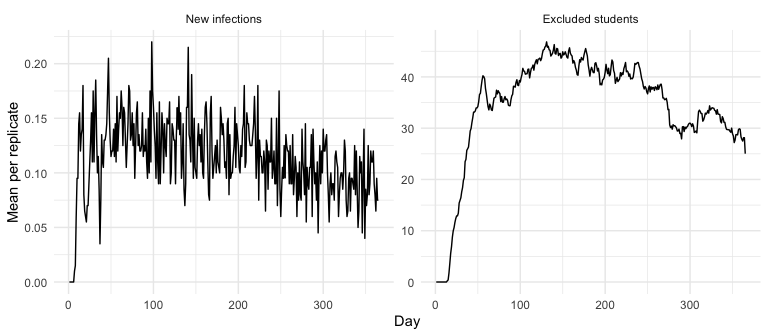

# Measles wastewater surveillance scenario


**Scenario wastewater-fast** (response: wastewater). Wastewater
surveillance with a faster turnaround: results two days after
collection.

This report is rendered from [report.qmd](../report.qmd) by the Makefile
target **wastewater-fast**; scenario settings are in
[scenarios.yml](../scenarios.yml), and outputs in
[results/wastewater-fast](../results/wastewater-fast). The model is an
exploratory simulation, not a forecast. The devcontainer pins epiworldR
to commit `2f1a5acc7835c44908fab53261d879afc4335e51` and the Census
helper package to `ddd9201f28b9908c033542f6a2445b84619af1c7`.

## Parameters

Defaults come from [data/parameters.csv](../data/parameters.csv), which
lists their sources; the scenario changes these:

| parameter        | default | scenario |
|:-----------------|:--------|:---------|
| ww_sampling_days | 1, 4    | 1, 4     |
| ww_lab_delay     | 4       | 2        |

## Population and contacts

The model has 120,000 agents, about a tenth of the 2025 Census estimate
for Salt Lake County, with its age distribution. Each agent is in the
community layer; students also join one school. Ages 5-9, 10-14 and
three fifths of 15-19 attend elementary, middle and high schools.
Students are dealt at random into schools of about 500; each simulated
school represents a real school of the same level, drawn with
probability proportional to its weighted population share, and keeps
that school’s MMR coverage. See
[data/utah/README.md](../data/utah/README.md) for sources and
limitations.

Contacts start from the household, work, other and school matrices. The
school layer takes the school contacts within each school age group,
divided among its students; the community layer keeps everything else.
Averaged over an age group, a student’s community and school contacts
add up to the all-setting total. Within a school, every pair of students
meets with the same daily probability.

``` r
# County age distribution, rounded to the model's population size.
age_limits <- seq(0, 75, by = 5)
census_path <- system.file(
  "extdata", "cc-est2025-syasex-49.csv", package = "multigroup.vaccine"
)
census <- multigroup.vaccine::getCensusData(
  state_fips  = "49",
  county_name = "Salt Lake County",
  year        = 2025,
  age_groups  = age_limits,
  csv_path    = census_path
)
shares <- census$age_pops / sum(census$age_pops)
pop <- floor(shares * p$n)
remaining <- p$n - sum(pop)
if (remaining > 0) {
  extra <- order(shares * p$n - pop, decreasing = TRUE)[seq_len(remaining)]
  pop[extra] <- pop[extra] + 1
}

# Reweight national setting-specific matrices and make contacts reciprocal.
us_path <- system.file(
  "extdata", "nc-est2025-agesex-res.csv", package = "multigroup.vaccine"
)
us <- read.csv(us_path)
us <- us[us$SEX == 0 & us$AGE < 999, ]
us_pop <- tapply(us$POPESTIMATE2025, findInterval(us$AGE, age_limits), sum)
weights <- (pop / sum(pop)) / as.numeric(us_pop / sum(us_pop))
settings <- c("Household", "Work", "Other", "School")
setting_contacts <- list()
for (setting in settings) {
  path <- file.path("data/epistorm", paste0(setting, "-M-by5_75-matrix.csv"))
  matrix_data <- read.csv(path, check.names = FALSE)
  contacts <- as.matrix(matrix_data[, -1])
  contacts <- t(t(contacts) * weights)
  pairs <- contacts * as.numeric(pop)
  setting_contacts[[setting]] <- (pairs + t(pairs)) / 2 / as.numeric(pop)
}
total_contacts <- Reduce(`+`, setting_contacts)

# Weight each school's within-district share by ACS district population.
schools <- read.csv(
  "data/utah/school_district_schoolID_data_Utah_2025.csv"
)
schools <- schools[schools$county == "Salt Lake", ]
acs <- read.csv(
  "data/utah/acs_Utah_2023_school_districts.csv",
  check.names  = FALSE,
  fileEncoding = "UTF-8-BOM"
)
district <- unique(schools$schooldistrictlocation)
labels <- ifelse(
  test = district == "SALT LAKE",
  yes  = "Salt Lake City",
  no   = tools::toTitleCase(tolower(district))
)
columns <- paste0(labels, " School District, UT")
district_pop <- vapply(
  X         = columns,
  FUN       = function(col) sum(acs[[col]][acs[[1]] %in% c(5, 10, 15, 16)]),
  FUN.VALUE = numeric(1)
)
school_weight <- district_pop[match(schools$schooldistrictlocation, district)] *
  schools$popfrac

# Ages 5-9, 10-14 and three fifths of 15-19 attend the three school levels.
age_group <- rep(seq_along(pop) - 1L, pop)
level <- rep(NA_integer_, p$n)
level[age_group == 1L] <- 1L
level[age_group == 2L] <- 2L
older <- which(age_group == 3L)
level[older[sample.int(length(older), floor(length(older) * 3 / 5))]] <- 3L

# Deal students into schools of about the target size.
school_assignment <- assign_schools(
  level        = level,
  source_level = schools$level,
  weight       = school_weight,
  size         = p$school_size
)
school_group <- school_assignment$school
school_source <- school_assignment$source

# Move within-age school contacts to the school layer so that, by age group,
# community plus school contacts match the all-setting matrix.
attendance <- as.numeric(tapply(!is.na(school_group), age_group, mean))
contact_split <- split_school_contacts(
  total      = total_contacts,
  school     = setting_contacts$School,
  attendance = attendance
)
school_probability <- school_contact_prob(
  school      = school_group,
  age_group   = age_group,
  per_student = contact_split$per_student
)

# The shedding kernel is normalized to one per prodromal-onset cohort; it
# runs from ww_t_start days before prodrome onset to ww_t_end after.
tau <- -p$ww_t_start:p$ww_t_end
rise <- p$ww_t_peak + p$ww_t_start
log_shedding <- ifelse(
  test = tau <= p$ww_t_peak,
  yes  = p$ww_log10_vpeak * (tau + p$ww_t_start) / rise,
  no   = p$ww_log10_vpeak * (p$ww_t_end - tau) / (p$ww_t_end - p$ww_t_peak)
)
kernel <- 10^log_shedding
kernel <- kernel / sum(kernel)
setup <- list(
  persons            = list(age_group = age_group, school = school_group),
  community          = contact_split$community,
  school_probability = school_probability,
  vaccinated         = integer(),
  kernel             = kernel
)
c(
  students = sum(!is.na(school_group)),
  schools  = length(school_source)
)
```

    students  schools 
       20635       41 

## Vaccination

Students take their school’s MMR coverage. Everyone else follows the
adult immunization assumptions used for the Utah/Arizona border in
multigroup.vaccine: under 1s are unvaccinated, ages 1-4 take the
county’s elementary-school coverage, ages 5-24 out of school the
high-school coverage, ages 25-44 the mean of the high-school coverage
and 0.95, ages 45-69 0.95, and agents aged 70 and over count as
vaccinated. Vaccination reduces susceptibility by 97% per contact.
Coverage is not effectiveness.

``` r
# County coverage by school level, weighted like the school draws.
level_coverage <- vapply(
  X         = 1:3,
  FUN       = function(j) {
    keep <- schools$level == j & !is.na(schools$vaxrate) &
      !is.na(school_weight)
    weighted.mean(schools$vaxrate[keep], school_weight[keep])
  },
  FUN.VALUE = numeric(1)
)

# Non-students: average the single-year rule over the ages out of school.
out_of_school <- lapply(seq_along(age_limits), function(g) {
  ages <- age_limits[g] + 0:4
  if (g == 4L) ages <- 18:19
  ages
})
band_coverage <- vapply(
  X         = out_of_school,
  FUN       = function(ages) {
    mean(community_coverage(
      age         = ages,
      elementary  = level_coverage[1],
      high_school = level_coverage[3],
      adult       = p$adult_vax_coverage,
      immune_age  = p$immune_age
    ))
  },
  FUN.VALUE = numeric(1)
)

# Students take their school's coverage, or their level's if it is missing.
vaccine_probability <- band_coverage[age_group + 1L]
students <- !is.na(school_group)
school_rate <- schools$vaxrate[school_source[school_group[students] + 1L]]
level_rate <- level_coverage[level[students]]
vaccine_probability[students] <- ifelse(
  test = is.na(school_rate),
  yes  = level_rate,
  no   = school_rate
)
setup$vaccinated <- which(runif(p$n) < vaccine_probability) - 1L

coverage <- data.frame(
  age_group = paste0(age_limits, c(paste0("-", age_limits[-1] - 1), "+")),
  agents    = pop,
  coverage  = round(tapply(vaccine_probability, age_group, mean), 3)
)
knitr::kable(coverage, row.names = FALSE)
```

| age_group | agents | coverage |
|:----------|-------:|---------:|
| 0-4       |   6999 |    0.696 |
| 5-9       |   7365 |    0.861 |
| 10-14     |   8150 |    0.869 |
| 15-19     |   8534 |    0.877 |
| 20-24     |   9443 |    0.874 |
| 25-29     |  10769 |    0.912 |
| 30-34     |   9808 |    0.912 |
| 35-39     |   8822 |    0.912 |
| 40-44     |   8508 |    0.912 |
| 45-49     |   8022 |    0.950 |
| 50-54     |   6754 |    0.950 |
| 55-59     |   5782 |    0.950 |
| 60-64     |   5444 |    0.950 |
| 65-69     |   5034 |    0.950 |
| 70-74     |   4229 |    1.000 |
| 75+       |   6337 |    1.000 |

## Calibrate transmission

Contacts stay fixed; we calibrate only the per-contact transmission
probability. The target is an average of 7 secondary infections per
imported case in a fully susceptible (unvaccinated) population with no
response, an illustrative assumption below published measles estimates.
The next-generation approximation gives the starting value, and
simulations with fixed seeds refine it, so scenarios with the same
population and natural history get the same rate.

``` r
# Start from the analytic value, then correct it with simulated R0.
p$transmission_rate <- transmission_for_r0(p, total_contacts)
analytic_rate <- p$transmission_rate
cal_setup <- setup
cal_setup$vaccinated <- integer()
cal_p <- p
cal_p$n_seed <- 10
cal_p$ndays <- 60
cal_seeds <- 42L + 1:5
cal_nsims <- 10L
for (iteration in 1:4) {
  secondary <- parallel::mclapply(
    X        = cal_seeds,
    FUN      = function(seed) {
      model <- build_model(
        p     = cal_p,
        setup = cal_setup,
        state = new.env(parent = emptyenv())
      )
      run_multiple(
        m        = model,
        ndays    = cal_p$ndays,
        nsims    = cal_nsims,
        seed     = seed,
        saver    = make_saver("reproductive"),
        nthreads = 1,
        verbose  = FALSE
      )
      r <- run_multiple_get_results(model, nthreads = 1)$reproductive
      sum(r$rt[r$source >= 0 & r$source_exposure_date == 0])
    },
    mc.cores = ncores
  )
  if (!all(vapply(secondary, is.numeric, TRUE))) stop(secondary)
  r0 <- sum(unlist(secondary)) /
    (length(cal_seeds) * cal_nsims * cal_p$n_seed)
  if (!is.finite(r0) || r0 <= 0) stop("Calibration produced no transmission")
  if (iteration < 4) {
    cal_p$transmission_rate <- min(1, cal_p$transmission_rate * p$R0 / r0)
  }
}
p$transmission_rate <- cal_p$transmission_rate
if (p$transmission_rate >= 1 || abs(r0 / p$R0 - 1) > 0.1) {
  stop("Calibration failed: simulated R0 ", round(r0, 2))
}
c(
  analytic_rate     = analytic_rate,
  transmission_rate = p$transmission_rate,
  simulated_r0      = r0
)
```

        analytic_rate transmission_rate      simulated_r0 
            0.1062152         0.1145500         6.9980000 

## Surveillance and response

25% of cases are reported. Each day of rash, a case is detected with
probability 0.065 and isolated, and hospitalized cases (2% of
infections) are always detected; the detection probability is solved so
that, together, they report 25% of cases. Detected cases are reported 3
days later. A reported student case excludes the unvaccinated students
of that school who have not been detected as cases. They return 42 days
after the school’s last reported case, and a school can be excluded more
than once.

Infected agents shed into wastewater from 0 days before prodrome onset
until 18 days after it, peaking at rash onset. Wastewater is sampled on
Mon and Thu, and results arrive 2 days after sampling. A sample is
positive if it reaches the limit of detection or, with probability
0.005, falsely. A positive result starts or extends a county-wide alert
of 42 days. In this scenario the alert reduces community contacts by 10%
and raises the daily detection probability to 0.078. Wastewater cannot
locate the outbreak, so it cannot act on a single school.

## Run the replicates

Each of 200 replicates draws an origin school uniformly at random and
infects 1 of its students. Every scenario uses the same replicate seeds,
population and vaccination, so replicate *i* of two scenarios is
identical until their settings make them diverge; compare scenarios
within replicates. Replicates run in parallel across forked R processes,
each with `run()`, because the R event cannot share threads.

``` r
replicate_seeds <- 1000L + seq_len(nsims)
school_ids <- seq_along(school_source) - 1L
runs <- parallel::mclapply(
  X        = seq_len(nsims),
  FUN      = function(i) {
    set.seed(replicate_seeds[i])
    seed_school <- school_ids[sample.int(length(school_ids), 1)]
    seeded <- which(school_group == seed_school) - 1L
    seeds <- seeded[sample.int(length(seeded), p$n_seed)]
    state <- new.env(parent = emptyenv())
    model <- build_model(p, setup, state, scenario$response, seeds = seeds)
    verbose_off(model)
    run(model, ndays = p$ndays, seed = replicate_seeds[i])
    c(
      list(
        replicate   = i,
        seed        = replicate_seeds[i],
        seed_school = seed_school
      ),
      state$runs[[1]]
    )
  },
  mc.cores = ncores
)
failed <- !vapply(runs, is.list, TRUE)
if (any(failed)) stop(runs[[which(failed)[1]]])
```

## Outputs

The report writes three tables, a figure, and a metadata file to
[results/wastewater-fast](../results/wastewater-fast);
[results/README.md](../results/README.md) describes every column. Counts
are for the 120,000-agent model; multiply by `county_scale` in
`metadata.csv` for county totals.

``` r
# Summarize each run and keep its daily series and age distribution.
first_day <- function(x) if (any(x, na.rm = TRUE)) which(x)[1] else NA_integer_
replicates <- rbindlist(lapply(runs, function(x) {
  d <- x$daily
  data.table(
    scenario                    = scenario$name,
    response                    = scenario$response,
    replicate                   = x$replicate,
    seed                        = x$seed,
    seed_school                 = x$seed_school,
    infections                  = sum(x$infections_by_age),
    rash_cases                  = sum(d$new_rash),
    detected_cases              = sum(d$new_detected),
    reported_cases              = sum(d$reported),
    first_report_day            = first_day(d$reported > 0),
    admissions                  = sum(d$admissions),
    hospital_days               = sum(d$hospitalized),
    isolation_days              = sum(d$isolated),
    last_infection_day          = max(c(0L, which(d$new_infections > 0))),
    active_at_end               = x$active_at_end,
    samples                     = sum(!is.na(d$ww_positive)),
    positive_samples            = sum(d$ww_positive, na.rm = TRUE),
    false_positive_samples      = sum(d$ww_false, na.rm = TRUE),
    alerts                      = x$alerts,
    first_alert_day             = x$first_alert,
    first_true_positive_day     = first_day(d$ww_positive & !d$ww_false) +
      p$ww_lab_delay,
    alert_days                  = sum(d$alert_on),
    reduced_contact_person_days = if (scenario$response == "wastewater") {
      p$n * p$community_contact_reduction * sum(d$alert_on)
    } else {
      0
    },
    exclusion_episodes          = x$episodes,
    first_exclusion_day         = x$first_exclusion,
    excluded_student_days       = sum(d$excluded)
  )
}))
daily <- rbindlist(lapply(runs, function(x) {
  cbind(
    data.table(scenario = scenario$name, replicate = x$replicate),
    x$daily
  )
}))
infections_by_age <- rbindlist(lapply(runs, function(x) {
  data.table(
    scenario   = scenario$name,
    replicate  = x$replicate,
    age_group  = coverage$age_group,
    infections = x$infections_by_age
  )
}))

# Record what produced the results.
metadata <- data.table(
  name  = c(
    "scenario", "response", "description", "n", "county_population",
    "county_scale", "replicates", "schools", "transmission_rate",
    "simulated_r0", "epiworldR_commit", "git_commit", "rendered"
  ),
  value = c(
    scenario$name, scenario$response, scenario$description, p$n,
    sum(census$age_pops), sum(census$age_pops) / p$n, nsims,
    length(school_source), p$transmission_rate, r0,
    packageDescription("epiworldR")$RemoteSha %||% NA_character_,
    system("git rev-parse HEAD", intern = TRUE),
    format(Sys.time(), "%Y-%m-%d %H:%M %Z")
  )
)
dir.create(out_dir, showWarnings = FALSE, recursive = TRUE)
fwrite(replicates, file.path(out_dir, "replicates.csv"))
fwrite(daily, file.path(out_dir, "daily.csv.gz"))
fwrite(infections_by_age, file.path(out_dir, "infections_by_age.csv"))
fwrite(metadata, file.path(out_dir, "metadata.csv"))
```

## Results

Outcomes per replicate, including introductions that die out. Outbreak
sizes are skewed, so the table shows quantiles as well as means.

|  | outcome | mean | median | q90 | max |
|:---|:---|---:|---:|---:|---:|
| infections | infections | 42.6 | 5.0 | 127.1 | 516 |
| admissions | admissions | 0.7 | 0.0 | 3.0 | 8 |
| hospital_days | hospital_days | 5.1 | 0.0 | 17.2 | 67 |
| isolation_days | isolation_days | 21.3 | 3.5 | 66.0 | 286 |
| excluded_student_days | excluded_student_days | 12544.6 | 2310.0 | 42386.1 | 158789 |
| exclusion_episodes | exclusion_episodes | 3.4 | 1.0 | 10.2 | 44 |
| samples | samples | 105.0 | 105.0 | 105.0 | 105 |
| positive_samples | positive_samples | 6.0 | 2.0 | 20.0 | 55 |
| false_positive_samples | false_positive_samples | 0.5 | 0.0 | 1.0 | 3 |
| alerts | alerts | 1.2 | 1.0 | 3.0 | 5 |
| alert_days | alert_days | 87.6 | 45.0 | 245.6 | 342 |
| reduced_contact_person_days | reduced_contact_person_days | 1051740.0 | 540000.0 | 2947200.0 | 4104000 |

Across replicates, 27% of infections were reported (target 25%). Of the
replicates, 139 had a reported case. In those, the median day of the
first case report was 35, and of the first true-positive wastewater
result 52.

<div id="fig-incidence">



Figure 1: Mean daily new infections and excluded students across
replicates, including those that die out.

</div>

## Limitations

School assignments approximate enrollment from district population
shares, and the model holds a sample of schools rather than every
school. The wastewater process assumes the whole modeled population
contributes to one catchment, so an alert cannot be traced to a school.
Vaccination reduces each contact’s infection probability rather than
fully protecting a share of vaccinated agents, and adult coverage is
assumed. Excluded students keep their community contacts, and
non-student cases trigger no school action. The reporting fraction comes
from one outbreak in southwest Utah and may differ in Salt Lake County.
These are modeling assumptions, not estimates validated against observed
Salt Lake County outbreaks.
